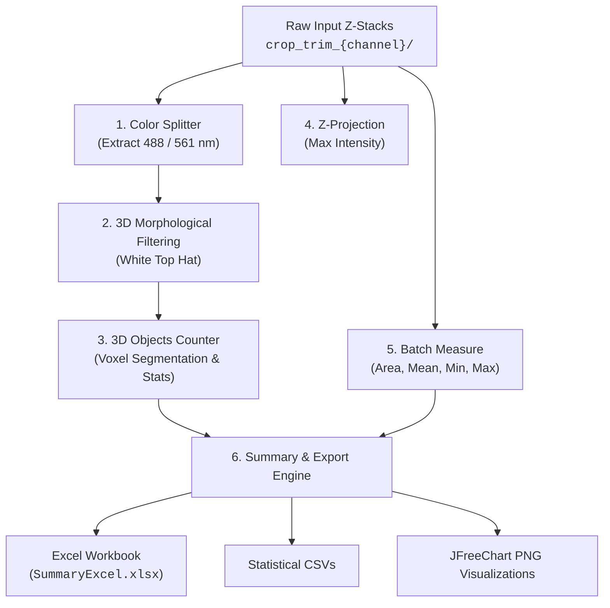
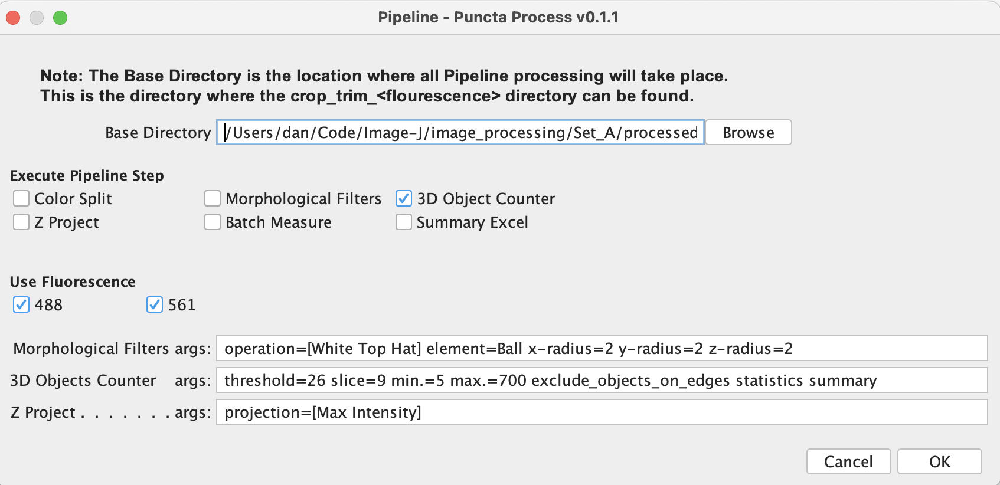
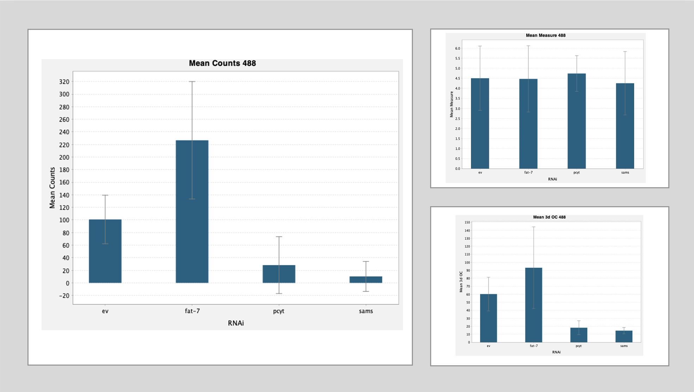
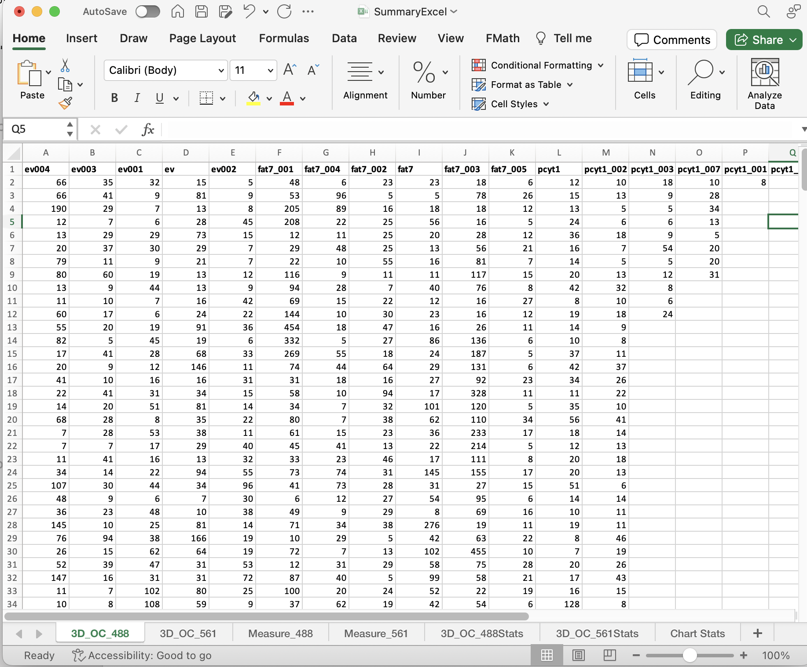

# Puncta Process ImageJ Plugin

[](https://opensource.org/licenses/MIT)
[](https://imagej.net/software/fiji/)
[](https://groovy-lang.org/)
[](https://adoptium.net/)

An automated image processing and quantification pipeline for Fiji/ImageJ developed for the **Amy Walker Lab** at **UMass Chan Medical School**. 

`puncta_process_plugin` automates 3D puncta segmentation, volume quantification, maximum-intensity projections, fluorescent intensity measurements, and statistical reporting from multi-channel confocal fluorescence microscopy z-stacks.

---

## Table of Contents

- [Overview](#overview)
- [Pipeline Architecture](#pipeline-architecture)
- [Directory Layout](#directory-layout)
- [Prerequisites & Dependencies](#prerequisites--dependencies)
- [Installation](#installation)
  - [Method 1: Fiji Update Site (Recommended)](#method-1-fiji-update-site-recommended)
  - [Method 2: Manual Installation](#method-2-manual-installation)
- [Usage Guide](#usage-guide)
  - [1. Launching the Plugin](#1-launching-the-plugin)
  - [2. Configuration Parameters](#2-configuration-parameters)
  - [3. Pipeline Stages](#3-pipeline-stages)
- [Output & Reporting](#output--reporting)
- [Screenshots](#screenshots)
- [Development & Building](#development--building)
- [Known Issues & Recommendations](#known-issues--recommendations)
- [License & Citation](#license--citation)

---

## Overview

Quantifying subcellular structures such as lipid droplets, protein aggregates, or synaptic puncta across large sets of 3D microscopy images is computationally intensive and error-prone when performed manually. 

`puncta_process_plugin` provides an end-to-end, reproducible workflow:
1. **Multi-channel Extraction:** Splits composite RGB z-stacks into individual fluorescence channels (e.g., 488 nm and 561 nm).
2. **Background Correction & Enhancement:** Applies 3D morphological filtering (White Top Hat) to isolate punctate signals from diffuse background.
3. **3D Object Quantification:** Detects objects in 3D space, extracts voxel counts and volumetric statistics, and dynamically bounds threshold values.
4. **Projection & Batch Intensity Measurements:** Generates 2D maximum intensity projections and computes whole-field / ROI intensity statistics.
5. **Automated Analytics & Visualization:** Aggregates findings across samples into structured Microsoft Excel (`.xlsx`) workbooks and generates publication-ready bar charts with error bars via JFreeChart.

---

## Pipeline Architecture



---

## Directory Layout

### Expected Input Structure

Before running the plugin, point the **Base Directory** to a folder containing pre-cropped input images grouped by fluorescence wavelength:

```text
<Base Directory>/
├── crop_trim_488/
│   ├── sample_01.tif
│   ├── sample_02.tif
│   └── ...
└── crop_trim_561/
    ├── sample_01.tif
    ├── sample_02.tif
    └── ...
```

### Generated Output Structure

The pipeline generates dedicated stage directories and an aggregated summary folder within the selected Base Directory:

```text
<Base Directory>/
├── color_split_488/          # Extracted 488 nm single-channel images
├── color_split_561/          # Extracted 561 nm single-channel images
├── color_hold/               # Non-selected channels stored for reference
├── White_Top_Hat_488/        # Filtered 3D z-stacks (488 nm)
├── White_Top_Hat_561/        # Filtered 3D z-stacks (561 nm)
├── 3D_OC_488/                # 3D Objects Counter CSV statistics per image
├── 3D_OC_561/                # 3D Objects Counter CSV statistics per image
├── max_488/                  # 2D Maximum Intensity Projections (488 nm)
├── max_561/                  # 2D Maximum Intensity Projections (561 nm)
├── measure_488/              # Batch measurement CSV (488 nm)
├── measure_561/              # Batch measurement CSV (561 nm)
├── Excel_Summary/            # Final aggregated reports
│   ├── SummaryExcel.xlsx     # Consolidated multi-sheet Excel workbook
│   ├── 3D_OC_488.csv         # Matrix of object counts per image
│   ├── 3D_OC_488Stats.csv    # Summary statistics (mean, stdDev, min, max)
│   ├── Chart_*.csv           # Data underlying generated charts
│   └── *.png                 # Generated statistical bar charts
├── log-<timestamp>.txt       # High-level pipeline execution log
└── debug-<timestamp>.txt     # Detailed debug and timing log
```

---

## Prerequisites & Dependencies

- **[Fiji (ImageJ)](https://imagej.net/software/fiji/):** Latest stable release recommended.
- **[MorphoLibJ](https://imagej.net/plugins/morpholibj):** Required for 3D White Top Hat mathematical morphology filtering.
  - *Installation:* In Fiji, open `Help > Update...` > `Manage update sites` > check **IJ-BP-Plugins** (or **MorphoLibJ**) > `Apply changes` > restart Fiji.
- **3D Objects Counter:** Bundled natively with Fiji distributions.
- **Java Runtime:** Java 8 or higher (standard within modern Fiji installations).

---

## Installation

### Method 1: Fiji Update Site (Recommended)

1. Launch **Fiji**.
2. Navigate to **Help** > **Update...** to open the ImageJ Updater.
3. Click **Manage update sites**.
4. Check the **Puncta_Process** update site (if registered) and ensure **IJ-BP-Plugins** (MorphoLibJ) is checked.
5. Click **Apply changes** and restart Fiji.

### Method 2: Manual Installation

1. Download the latest `puncta_process_plugin-<version>.jar` from the [Releases](https://github.com/DanHUMassMed/puncta_process_plugin/releases) page (or build from source).
2. Copy the `.jar` file into your Fiji installation's plugins directory:
   - **macOS:** `/Applications/Fiji.app/plugins/`
   - **Linux:** `/path/to/Fiji.app/plugins/`
   - **Windows:** `C:\path\to\Fiji.app\plugins\`
3. Restart Fiji. The plugin will be accessible under **Plugins** > **Process** > **Puncta Process**.

---

## Usage Guide

### 1. Launching the Plugin

In Fiji, open:
```text
Plugins  ▶  Process  ▶  Puncta Process
```

### 2. Configuration Parameters

The plugin displays an interactive configuration dialog allowing modular step execution:

| Parameter | Default Value | Description |
| :--- | :--- | :--- |
| **Base Directory** | Home directory | The root directory containing `crop_trim_<channel>` folders. |
| **Execute Pipeline Step** | All enabled | Checkboxes to toggle individual execution steps: *Color Split*, *Morphological Filters*, *3D Object Counter*, *Z Project*, *Batch Measure*, *Summary Excel*. |
| **Use Fluorescence** | `488`, `561` | Channels to process through the pipeline. |
| **Morphological Filters args** | `operation=[White Top Hat] element=Ball x-radius=2 y-radius=2 z-radius=2` | MorphoLibJ 3D filter settings. |
| **3D Objects Counter args** | `threshold=26 slice=9 min.=5 max.=700 exclude_objects_on_edges statistics summary` | Segmentation threshold, minimum/maximum voxel volume filters. |
| **Z Project args** | `projection=[Max Intensity]` | Projection algorithm for 2D summary stacks. |

*Note: User parameters and directory selections are automatically persisted across sessions via ImageJ `Prefs`.*

### 3. Pipeline Stages

1. **Color Split:** Reads input RGB images from `crop_trim_<channel>` and splits them into red, green, and blue stacks. 561 nm maps to red and 488 nm maps to green; non-target channels are preserved in `color_hold/`.
2. **Morphological Filters (White Top Hat):** Enhances bright punctate features while suppressing heterogeneous background illumination using a 3D ball structuring element.
3. **3D Objects Counter:** Identifies connected 3D puncta. The pipeline automatically evaluates the image maximum intensity and caps the user threshold if it exceeds the image dynamic range to avoid segmentation failures.
4. **Z-Projection:** Creates 2D maximum intensity projections (`Max_*.tif`) for visual inspection.
5. **Batch Measure:** Measures area, mean intensity, min, and max values across the raw stacks.
6. **Summary Excel:** Synthesizes voxel volume distributions, calculates sample means and standard deviations, compiles multi-sheet `.xlsx` workbooks, and exports charts.

---

## Output & Reporting

The `Excel_Summary/` directory compiles primary metrics across all processed images:

- **Worksheets in `SummaryExcel.xlsx`:**
  - `3D_OC_<channel>`: Matrix containing object voxel volumes per sample.
  - `Measure_<channel>`: Batch measurement tables (Area, Mean, Min, Max).
  - `3D_OC_<channel>Stats`: Column statistics per sample (Count, Sum, Mean, StdDev, Min, Max).
  - `Chart Stats`: Consolidated statistical values used to construct bar plots.
- **Visualization Artifacts:** Publication-ready PNG bar charts showing condition averages with standard error / standard deviation error bars.

---

## Screenshots

### Pipeline Configuration Dialog


### Automated Statistical Bar Charts


### Consolidated Multi-Sheet Excel Output


---

## Development & Building

### Prerequisites for Building
- Java Development Kit (JDK) 8 or higher
- Gradle wrapper (included in repository)

### Build Commands

Build the plugin JAR:
```bash
./gradlew jar
```

Run test suite:
```bash
./gradlew test
```

Clean build artifacts:
```bash
./gradlew clean
```

### Local Deployment
A helper script is provided to build and deploy the plugin directly into a local Fiji instance:
```bash
chmod +x deploy.sh
./deploy.sh
```
*(Deploys the compiled JAR to `/Applications/Fiji.app/plugins/` and relaunches Fiji).*

---

## Known Issues & Recommendations

A recent comprehensive code review identified several technical items to be aware of when extending or modifying this plugin:

- **Directory Sub-traversal:** In `ProcessDirectory.groovy`, directory recursion calls `processDirectory(file)` which lacks an overloaded parameter method. Avoid nested subdirectories inside `crop_trim_<channel>`.
- **Destructive Directory Creation:** `ProcessDirectory` executes `deleteDir()` on output folders prior to running each stage. Ensure output directories do not contain irreplaceable data.
- **Filename Slicing:** Several modules use fixed negative character index slicing (`[0..-5]`), which presumes 3-character extensions (`.tif`). Files with `.tiff` or multi-period filenames may cause misnamed outputs.
- **Thread Timing:** Several steps utilize `sleep(100)` to synchronize window events. For headless or cluster execution, headless ImageJ API calls are recommended.

---

## License & Citation

Distributed under the **MIT License**. See [`LICENSE`](file:///Users/dan/Code/groovy/puncta_process_plugin/LICENSE) for more information.

### Lab & Authors
- **Amy Walker Lab**  
  Department of Molecular Medicine  
  University of Massachusetts Chan Medical School  
  Worcester, MA, USA  
- **Maintainer:** [Daniel Higgins](https://github.com/DanHUMassMed) (`daniel.higgins@umassmed.edu`)
